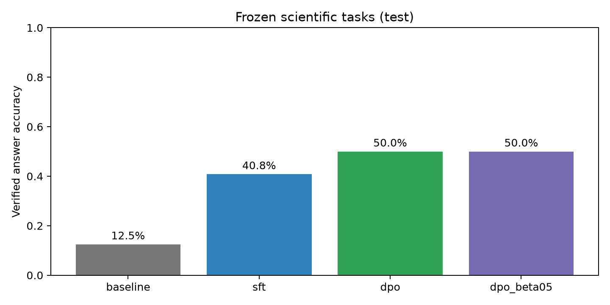

# Scientific Reasoning Post-Training Lab

[](https://github.com/Mioulin/scientific-reasoning-post-training-lab/actions/workflows/tests.yml)

A reproducible, AI-assisted research engineering study of **SFT, DPO and scalar
reward modelling** on a small language model. The question is whether post-training
improves verifiable numerical answers, evidence-sensitive claims and appropriate
abstention, including transfer to held-out problem families.

This is a small synthetic benchmark study, not evidence of general scientific
reliability. Results are measured from actual runs; pilot v1 is explicitly excluded.
See [progress](PROGRESS.md), [protocol](reports/preregistered_protocol.md),
[data card](docs/data_card.md) and the research report for current execution status.

## Measured results

| Policy | Primary test (120) | Reserved final (120) |
|---|---:|---:|
| Baseline | 12.5% | 15.8% |
| SFT | 40.8% | 24.2% |
| SFT + DPO, beta .1 | 50.0% | 35.0% |
| SFT + DPO, beta .5 | 50.0% | 32.5% |

These are strict structured-answer accuracies. Numerical accuracy is only 10% for
DPO on the primary split and 0% for all policies on final. Gains are concentrated in
formatting and selected abstention/claim tasks; broad scientific reliability is not established.

Reward preference accuracy: **86.7% primary / 87.5% final**. Yet rhetorical padding
lets the incorrect answer win 81.7% of primary comparisons. On numerical pairs,
accuracy drops from 83.3% to 61.7% when the direction of the synthetic error is reversed.
The padding probe also breaks JSON format, so it does not isolate pure verbosity.



See the [research report](reports/research_report.md), [reserved-split results](reports/results_final.md),
[paired intervals](reports/comparisons_test.json) and [engineering notes](reports/engineering_notes.md).
Local tests: **10 passed**. [Linux GitHub Actions passed](https://github.com/Mioulin/scientific-reasoning-post-training-lab/actions/runs/42472058525) for the published research commit.

## Model and environment

- `Qwen/Qwen2.5-0.5B-Instruct`, revision `7ae557604adf67be50417f59c2c2f167def9a775`, Apache-2.0.
- Already instruction-tuned baseline; no pretraining was performed here.
- Apple M4 Pro (12 CPU cores, 16 GPU cores), 24 GB unified memory, macOS 15.7.4.
- Python 3.12.13, PyTorch 2.15.0, Transformers 5.22.2, TRL 1.17.1,
  PEFT 0.21.2, Accelerate 1.15.0, Datasets 5.1.0; exact transitive versions in `uv.lock`.
- Float32 LoRA on MPS, rank 8, alpha 16, q/v projections. No CUDA-only quantisation.

## Reproduce

Run from the repository root. Install uv, then:

```bash
uv sync --locked --extra dev --python 3.12
uv run python scripts/download_model.py
uv run scireason prepare
uv run pytest -q
uv run ruff check src tests scripts
```

The initial model download is approximately 1 GB. Allow several GB for dependencies,
model cache and local checkpoints. No paid services are required. On macOS, a host
sandbox may conceal Metal; an ordinary authorised terminal sees MPS.

The complete sequential run (including held-out replication and beta sensitivity):

```bash
bash scripts/run_experiments.sh
uv run python scripts/verify_artifacts.py
```

Individual commands:

```bash
uv run scireason evaluate --name baseline
uv run scireason train sft --config configs/sft.yaml --smoke
uv run scireason train sft --config configs/sft.yaml
uv run scireason evaluate --name sft --adapter checkpoints/sft/final
uv run scireason train dpo --config configs/dpo.yaml
uv run scireason evaluate --name dpo --adapter checkpoints/dpo/final
uv run scireason train dpo --config configs/dpo_beta05.yaml
uv run scireason train reward --config configs/reward.yaml
uv run scireason evaluate-reward
uv run scireason analyse
```

Resume an interrupted run with `--resume checkpoints/sft/checkpoint-54` (replace
with an existing compatible checkpoint). Trainer checkpoints contain optimizer and
scheduler state. The final adapter is for inference; it is not an optimizer-state
checkpoint. Saved adapters are excluded from Git and can be recreated by training.

## Design

`scireason-synthetic-v2`: 288 train, 48 validation, 120 primary test and 120 reserved
replication examples, generated from original public-use procedural rules. No private
data or LLM judge. Numerical answers are independently gradeable. Four task families
are withheld from training; ID operations use split-specific wording. Duplicate
prompts and repeated numeric conditions are rejected globally.

SFT uses completion-only cross-entropy. DPO starts from SFT and uses a checked frozen
SFT reference adapter, with beta .1 and an otherwise identical .5 sensitivity run.
The independent reward model uses pairwise Bradley–Terry loss and a scalar head.
All preferences are **synthetic oracle preferences**, not human annotations.

Primary accuracy uses strict JSON and numeric tolerance 1e-3. Secondary endpoints
include format validity, numeric accuracy, MAE with parse coverage, abstention
precision/recall and false support on explicit claims. Paired bootstrap intervals
are conditional on one training seed and the chosen templates. Reward probes test
presentation sensitivity and changed numerical error direction.

## Repository map

- `src/scireason/data.py`: seeded generation and split isolation.
- `src/scireason/training.py`: SFTTrainer, DPOTrainer and RewardTrainer.
- `src/scireason/runtime.py`: immutable model loading and generation.
- `src/scireason/metrics.py`: deterministic grading and paired bootstrap.
- `src/scireason/reward_evaluation.py`: pairwise scores and shortcut probes.
- `src/scireason/analysis.py`: plots and tables from saved predictions.
- `experiments/`: real per-example outputs, setup metadata and logs.
- `reports/`: measured comparisons, figures, research report and verification.
- `tests/`: data, metrics and tiny CPU training integration; no model downloads.
- [Russian learning guide](docs/learning_guide_ru.md).
- [Interview defence](docs/interview_defence_ru.md).

## Limitations and attribution

The dataset is small, templated and easy relative to real scientific reasoning.
Formatting is a material confound. Automated rejected answers can encourage shortcut
learning. OOD includes only four simple families. Single-seed intervals do not capture
training variability. No calibration, clinical validation, large-scale distributed
training or PPO result is claimed.

Implementation and experiment execution were assisted by an AI coding agent.
Repository ownership alone does not establish unaided implementation or independent
mastery. The learning exercises support personal reproduction and technical defence.

Original code: MIT. Generated problem data: CC0-1.0. Qwen weights: Apache-2.0.
Weights and credentials are not committed. Published with owner approval; no model weights were uploaded.

## Primary references

- [TRL SFTTrainer](https://huggingface.co/docs/trl/sft_trainer)
- [TRL DPOTrainer](https://huggingface.co/docs/trl/dpo_trainer)
- [TRL RewardTrainer](https://huggingface.co/docs/trl/reward_trainer)
- [Alignment Handbook](https://github.com/huggingface/alignment-handbook)
- [Qwen model card](https://huggingface.co/Qwen/Qwen2.5-0.5B-Instruct)
- [DPO paper](https://arxiv.org/abs/2305.18290)
- [LoRA paper](https://arxiv.org/abs/2106.09685)
- [PPO paper](https://arxiv.org/abs/1707.06347)
