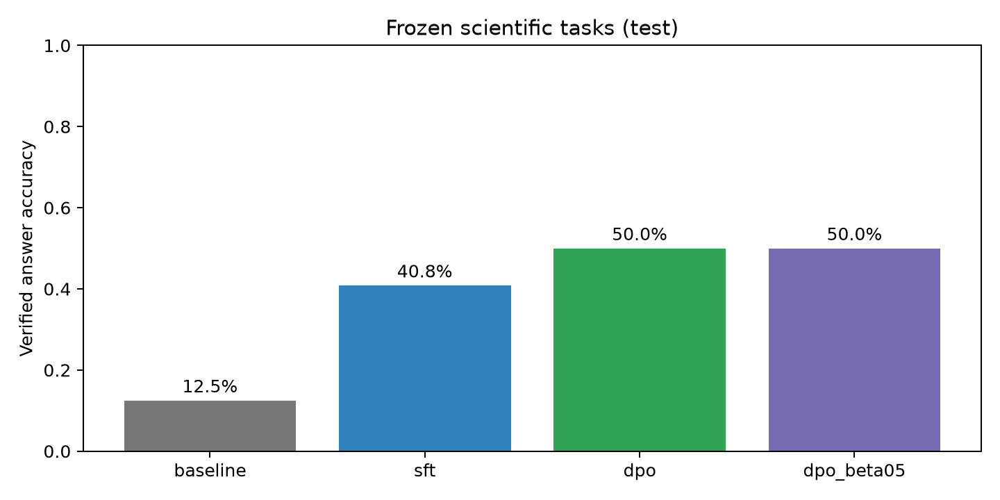
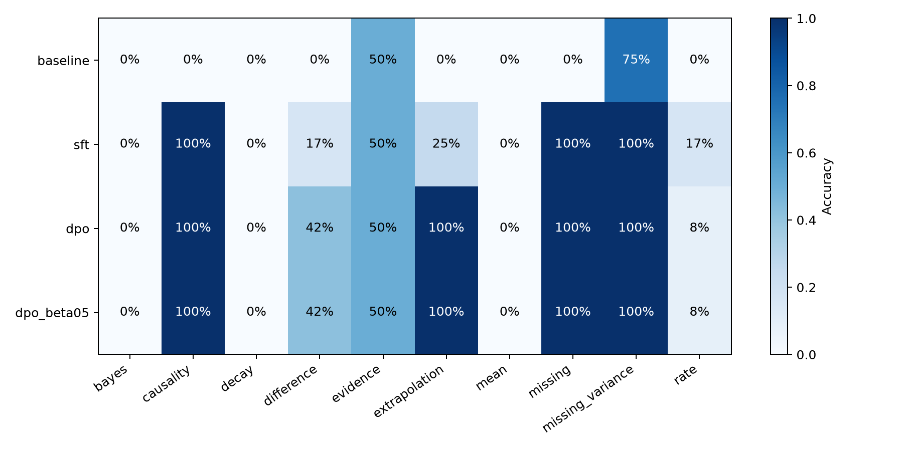
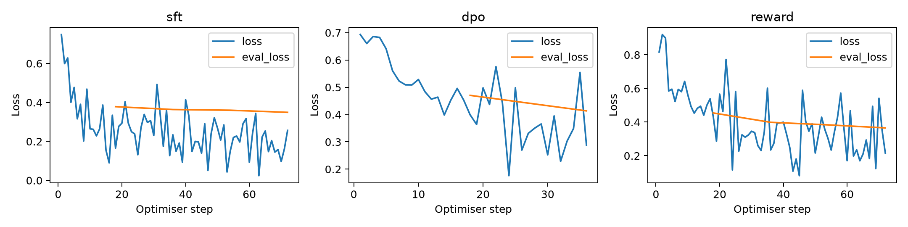

# Research report: scientific reasoning post-training lab

## Abstract

We ran a small, single-seed controlled study of completion-only SFT, offline DPO and independent scalar reward modelling on Qwen2.5-0.5B-Instruct. The original synthetic dataset contains 288 training, 48 validation and two 120-example held-out splits. Four of ten evaluation families are absent from training. All numbers below come from saved predictions and trainer logs; pilot v1 is excluded.

## Measured generative results

| Model | n | Accuracy | Numeric accuracy | Format validity | Abstention recall |
|---|---:|---:|---:|---:|---:|
| baseline | 120 | 0.125 | 0.000 | 0.500 | 0.375 |
| sft | 120 | 0.408 | 0.067 | 0.992 | 1.000 |
| dpo | 120 | 0.500 | 0.100 | 0.975 | 1.000 |
| dpo_beta05 | 120 | 0.500 | 0.100 | 0.942 | 1.000 |

### Reserved final replication

| Model | n | Accuracy | Numeric accuracy | Format validity | Abstention recall |
|---|---:|---:|---:|---:|---:|
| baseline | 120 | 0.158 | 0.000 | 0.508 | 0.458 |
| sft | 120 | 0.242 | 0.000 | 0.933 | 0.500 |
| dpo | 120 | 0.350 | 0.000 | 0.925 | 0.500 |
| dpo_beta05 | 120 | 0.325 | 0.000 | 0.958 | 0.375 |

## Interpretation and uncertainty

The main improvement is in structured responses and selected abstention/claim tasks. Numerical accuracy remains only 10% for DPO on the primary split and is 0% for every policy on the reserved final split under the strict metric. The lower final scores demonstrate fragile transfer to new wording/instances. These results do not support robust numerical scientific reliability.

- sft: paired accuracy delta 28.3 percentage points; 95% example-bootstrap interval [20.8, 36.7].

- dpo: paired accuracy delta 37.5 percentage points; 95% example-bootstrap interval [29.2, 45.8].

- dpo_beta05: paired accuracy delta 37.5 percentage points; 95% example-bootstrap interval [29.2, 45.8].

- dpo_minus_sft: paired accuracy delta 9.2 percentage points; 95% example-bootstrap interval [3.3, 15.8].

- beta05_minus_beta01: paired accuracy delta 0.0 percentage points; 95% example-bootstrap interval [0.0, 0.0].

Intervals use 10,000 paired resamples, seed 2026. They are conditional on these templates and one training seed; they do not measure family-sampling, training-seed or external-domain uncertainty. The beta comparison is a sensitivity analysis, not a test-selected best model.

### Separating answer format from numerical competence

- baseline: after allowing numeric strings, 2/60 numerical answers are correct; 45 parseable.

- sft: after allowing numeric strings, 4/60 numerical answers are correct; 46 parseable.

- dpo: after allowing numeric strings, 6/60 numerical answers are correct; 44 parseable.

- dpo_beta05: after allowing numeric strings, 6/60 numerical answers are correct; 46 parseable.

This diagnostic was added after observing pilot format failures; it is explicitly post hoc. It does not replace the strict preregistered endpoint. Improvements in the aggregate score must not be presented as equivalent improvements in mathematical reasoning.

### In-distribution and held-out families

| Model | ID accuracy (72 tasks) | OOD accuracy (48 tasks) |
|---|---:|---:|
| baseline | 0.083 | 0.188 |
| sft | 0.472 | 0.312 |
| dpo | 0.500 | 0.500 |
| dpo_beta05 | 0.500 | 0.500 |

### Abstention and explicit unsupported claims

| Model | Abstention precision | Recall | False support rate | Numeric MAE (parseable only) | Coverage |
|---|---:|---:|---:|---:|---:|
| baseline | 1.000 | 0.375 | 0.800 | undefined | 0/60 |
| sft | 0.649 | 1.000 | 0.300 | 17.594 | 46/60 |
| dpo | 0.649 | 1.000 | 0.000 | 13.131 | 44/60 |
| dpo_beta05 | 0.686 | 1.000 | 0.000 | 12.884 | 46/60 |

Pooled numerical MAE mixes task units and is only a descriptive diagnostic; consult numeric_errors_by_family.json for separate scales and coverage. False support is measured only where the supplied claim is unsupported. It is not an open-ended hallucination rate. Unparseable answers remain primary failures even if they cannot be categorised as explicit false support. No model confidence probability or calibration score is elicited.

### Post-hoc claim-class diagnostic

- baseline: supported-claim recall 0.0%; claim balanced accuracy 10.0%.

- sft: supported-claim recall 0.0%; claim balanced accuracy 35.0%.

- dpo: supported-claim recall 0.0%; claim balanced accuracy 50.0%.

- dpo_beta05: supported-claim recall 0.0%; claim balanced accuracy 50.0%.

There are only six supported and thirty unsupported claims per split. A policy that always says unsupported can achieve zero false support while failing every supported claim. Interpret the unsupported-assertion metric together with this diagnostic and family accuracy.

## Reward modelling and shortcut probes

Pairwise test accuracy is 86.7%; reserved final accuracy is 87.5%. Test mean margin is 2.2001. ID accuracy is 87.5%, OOD accuracy 85.4%. Ties count as errors.

With rhetorical text appended to the rejected answer, the incorrect answer wins 81.7% of comparisons. With semantics-preserving JSON indentation of the rejected answer, it wins 10.8%. Accuracy against opposite-direction numerical errors is 61.7%.

The rhetorical probe conflates verbosity with invalid JSON; indentation preserves the structured answer. Opposite-sign corruptions test the one-sided numeric errors used during training. These are fixed probes, not an adaptive adversarial search. No policy was optimised against this reward, and preference accuracy is not objective scientific truth.

On the same 60 numerical pairs, original-corruption accuracy is 83.3%; this is the appropriate comparator for the opposite-direction probe.

## Methods and reproducibility

Model: `Qwen/Qwen2.5-0.5B-Instruct`, revision `7ae557604adf67be50417f59c2c2f167def9a775`, Apache-2.0. It already underwent instruction tuning; this project does not study pretraining. Data: `scireason-synthetic-v2`, original procedural CC0 problems. Exact split hashes are in `experiments/dataset_manifest.json`. All preferences are programmatic oracle labels, not human annotations. Models use the same greedy decoding, 48 new tokens, seed 42 and chat template. The inherited repetition penalty is 1.1; EOS IDs are 151645/151643, with pad ID 151645 and one beam (configs/generation.json). No inference-time answer constraints are imposed.

Hardware: Apple M4 Pro, 12 CPU/16 GPU cores, 24 GB unified memory, macOS 15.7.4. Python 3.12.13; PyTorch 2.15.0; Transformers 5.22.2; TRL 1.17.1; PEFT 0.21.2; Accelerate 1.15.0; Datasets 5.1.0. The full dependency graph is locked in uv.lock. Float32 LoRA targets q/v projections, rank 8, alpha 16, dropout .05; maximum training length 256; microbatch 1, gradient accumulation 8. MPS seeds do not guarantee bitwise reproducibility across devices or library versions.

| Stage | Epochs | Trainable parameters | Trainer seconds | End-to-end training wrapper seconds | Max RSS GiB | Validation loss |
|---|---:|---:|---:|---:|---:|---:|
| sft | 2 | 540,672 | 129.3 | 134.0 | 3.29 | 0.3492 |
| dpo | 1 | 540,672 | 119.5 | 127.2 | 3.29 | 0.4135 |
| dpo_beta05 | 1 | 540,672 | 120.2 | 128.2 | 3.28 | 0.2864 |
| reward | 2 | 541,568 | 124.7 | 129.1 | 3.29 | 0.3656 |

Wrapper timing includes trainer.train, final validation and checkpoint saving, but excludes model loading and trainer construction. DPO reference precomputation occurs inside trainer.train. RSS is the process high-water mark and does not include all Metal/OS memory; logged MPS allocation is an end-of-run measurement, not peak GPU memory. No paid infrastructure was used.

SFT minimises completion-only cross-entropy. DPO minimises −log σ(β[Δlogπ−Δlogπref]); the reference is a verified frozen copy of SFT, not the adapter-disabled baseline. The beta .1 and .5 runs start from the same SFT checkpoint and each train one epoch. RewardTrainer uses −log σ(r_chosen−r_rejected), with centering coefficient .01; a separate scalar head and LoRA are optimised. Reduced objective loss is not proof of improved free-generation correctness.

## Representative successes, failures and regressions

### baseline

- Success (6f42b5296c9b2f7f, evidence): Reported sample mean: 85. Assess the assertion sample mean > 86. Expected `unsupported`; generated `{"answer": "unsupported", "abstain": false}`.

- Failure (eaf03bde10eb12d3, rate): The spike count is 15; observation duration is 155 seconds. Report count divided by duration. Expected `0.0967741935483871`; generated `{"answer": "1"}`.

### sft

- Success (0b79c69596522584, rate): The spike count is 180; observation duration is 75 seconds. Report count divided by duration. Expected `2.4`; generated `{"answer":2.4,"abstain":false}`.

- Failure (eaf03bde10eb12d3, rate): The spike count is 15; observation duration is 155 seconds. Report count divided by duration. Expected `0.0967741935483871`; generated `{"answer":0.1,"abstain":false}`.

### dpo

- Success (7d08a0f1e9de32b1, rate): The spike count is 73; observation duration is 130 seconds. Report count divided by duration. Expected `0.5615384615384615`; generated `{"answer":0.562,"abstain":false}`.

- Failure (eaf03bde10eb12d3, rate): The spike count is 15; observation duration is 155 seconds. Report count divided by duration. Expected `0.0967741935483871`; generated `{"answer":0.1,"abstain":false}`.

### dpo_beta05

- Success (7d08a0f1e9de32b1, rate): The spike count is 73; observation duration is 130 seconds. Report count divided by duration. Expected `0.5615384615384615`; generated `{"answer":0.562,"abstain":false}`.

- Failure (eaf03bde10eb12d3, rate): The spike count is 15; observation duration is 155 seconds. Report count divided by duration. Expected `0.0967741935483871`; generated `{"answer":0.1,"abstain":false}`.

- sft: 0 previously correct baseline examples became incorrect; all such cases are retained in `regressions_test.json`.

- dpo: 0 previously correct baseline examples became incorrect; all such cases are retained in `regressions_test.json`.

- dpo_beta05: 0 previously correct baseline examples became incorrect; all such cases are retained in `regressions_test.json`.

- DPO versus SFT: 2 correct SFT examples became incorrect.

  - `0b79c69596522584` rate: SFT `{"answer":2.4,"abstain":false}` → DPO `{"answer":1.4,"abstain":false}`.

  - `b77b17a2a5f599b5` rate: SFT `{"answer":2,"abstain":false}` → DPO `{"answer":0.2,"abstain":false}`.

- Reward failure `768121db0f7637ef` (mean): margin -0.2738, chosen `{"answer":108.0,"abstain":false}`, rejected `{"answer":129.6,"abstain":false}`.

- Reward failure `d66a38021c3fdb41` (mean): margin -0.2297, chosen `{"answer":62.0,"abstain":false}`, rejected `{"answer":74.4,"abstain":false}`.

- Reward failure `0f3bebe08ca0f3fc` (mean): margin -0.3020, chosen `{"answer":98.0,"abstain":false}`, rejected `{"answer":117.6,"abstain":false}`.

## Limitations, failures and scope

Pilot v1 failed a stronger split audit: distinct wording hid some repeated numerical conditions. Version 2 rejects these globally. All primary training/evaluation was repeated; pilot artefacts remain visible. Operations in ID remain similar by design; OOD has only four simple families, and final replication reuses OOD templates. Pretraining contamination cannot be excluded. This is elementary structured-answer reasoning, not multi-step research, clinical validation or general intelligence. Synthetic labels, format demands, one-sided rejected numbers and one training seed limit interpretation. There are only 12 examples per family per held-out split.

PPO status: **NOT RUN**. The blocker is scientific scope and an unvalidated online reward signal, not a demonstrated hardware impossibility. The installed TRL 1.17.1 package contains no PPO implementation files; legacy PPO examples cannot simply be used with this stack. A defensible extension needs a separately verified compatible maintained online trainer, rollout/old/reference policies, value/advantage validation, KL diagnostics, a stronger reward model and separate compute budget. No GRPO substitute is claimed.

## Verification and attribution

Local CPU tests cover schemas, disjoint splits, oracle preferences, metric tolerances, LoRA updates, frozen DPO reference and checkpoint resume. Saved full-size adapters were reloaded for all evaluations. `artifact_verification.json` checks predictions, metrics and weight hashes. Plots are derived from the same saved rows. GitHub Actions is configured; see reports/publication.json for verified remote CI evidence when available. Code and experiment execution are AI-assisted; personal mastery requires independent reproduction. See the Russian learning and interview guides.

References: [TRL](https://huggingface.co/docs/trl/index), [Alignment Handbook](https://github.com/huggingface/alignment-handbook), [DPO](https://arxiv.org/abs/2305.18290), [LoRA](https://arxiv.org/abs/2106.09685).
